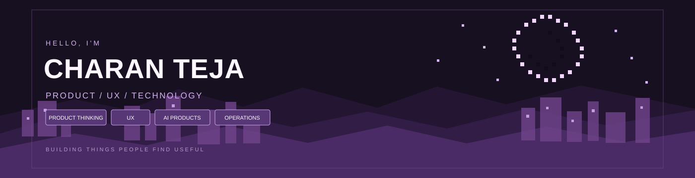
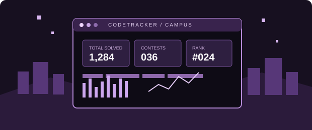
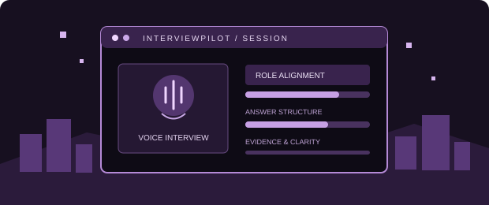

 

# Hi, I'm Charan Teja

**Product · UX · Technology · Operations**

Artificial Intelligence & Machine Learning graduate who enjoys turning user problems into useful digital products.

[Portfolio](https://charan.ofzen.in/) &nbsp;·&nbsp; [LinkedIn](https://www.linkedin.com/in/charan-tej-neelam-bb0a9a302) &nbsp;·&nbsp; [Email](mailto:charantej111n@gmail.com)

---

## About me

I'm a B.Tech graduate from **Aditya University**. I started with technology and design, then moved closer to product by working on real products, understanding user needs, shaping experiences and taking ideas through implementation and iteration.

I like working across the space between users, business goals and engineering. My experience includes product design, feature definition, frontend and backend implementation, testing, product support and operations.

I'm currently exploring **Product Management, Associate Product Manager, Product Analyst, Product Operations and Project Coordinator** opportunities in the UAE. Open to Dubai, Abu Dhabi and immediate joining.

---

## Tech stack

**Product and design**

  

**Development**

  

**Data, backend and workflow**

  

  
  
  

---

## Featured projects

<table>
<tr>
<td width="50%" valign="top">

### [CodeTracker ↗](https://github.com/Charantej111/Codetracker)

**Coding progress for students and institutions**

Brings coding activity from LeetCode, Codeforces, CodeChef, HackerRank, GeeksforGeeks and AtCoder into one place. Students can follow progress while faculty and placement teams get a consolidated view of activity.

Product thinking · UX · Analytics · Implementation

What I worked on

- Product workflows for students, faculty and placement teams.
- Consolidated coding profiles, progress views and leaderboards.
- UX, frontend implementation, validation and iteration.
- Balancing external platform data with a usable product experience.

<a href="https://github.com/Charantej111/Codetracker">View repository ↗</a>

</td>
<td width="50%" valign="top">

### [InterviewPilot ↗](https://github.com/Charantej111/InterviewPilot)

**Interview practice based on the candidate, not generic prompts**

Uses a candidate's resume and target role to shape interview questions, follow-ups, structured answer evaluation and feedback.

AI product · UX · Interview workflows · Evaluation

What I worked on

- Product definition and interview setup flow.
- Resume and job-description analysis.
- Interview generation, adaptive follow-ups and evaluation workflows.
- Frontend, backend integration, AI workflows and testing.

<a href="https://github.com/Charantej111/InterviewPilot">View repository ↗</a>

</td>
</tr>
<tr>
<td width="50%" valign="top">

### [Trace ↗](https://github.com/Charantej111/Trace)

**Customer feedback that leads to product decisions**

Brings together app reviews and files such as CSV, Excel and JSON to help identify recurring problems, understand supporting evidence and connect insights to prioritization.

Product discovery · Feedback analysis · Prioritization

What I worked on

- Feedback ingestion and normalization workflows.
- Problem grouping and emerging issue analysis.
- Evidence-backed opportunity scoring.
- Product decision records and roadmap traceability.
- Product concept, UX, implementation and validation.

<a href="https://github.com/Charantej111/Trace">View repository ↗</a>

</td>
<td width="50%" valign="top">

### CareerOS

**A workspace for career progress**

A career planning product for students and professionals, bringing together a daily planner, roadmaps, projects, job tracking and skill development.

Product design · Full-stack build · 0 to 1

What I worked on

I built CareerOS end-to-end, including:
- Product concept and user experience.
- Frontend and backend implementation.
- Database and authentication.
- Deployment and iteration.

</td>
</tr>
</table>

### Other work

**Delizoo** · Food delivery product. Contributed across product design, web experience and launch-related operations, working with the wider team.

**ApplyQ** · Job discovery and quick-apply experience for college students, covering on-campus placement opportunities and off-campus jobs. The source repository is private.

---

## Experience

| Role | Organization | Period |
|---|---|---|
| Operations Lead | Ofzen | 2025 onwards |
| Product Support & Validation Intern | Aditya University | May 2025 – June 2025 |
| AI/ML Intern | Nxt24 Tech Solutions | June 2024 – August 2024 |

## Education and highlights

**B.Tech, Artificial Intelligence & Machine Learning**  
Aditya University · 2022–2026 · 75%, First Class

- Bajaj HackRx 6.0 finalist.
- NPTEL Elite Silver Certification in Internet of Things.
- TCS Career Edge certification.

---

## Find me here

  
  
  

Interested in working with thoughtful teams on useful products. Based in the UAE and open to product and project opportunities.
