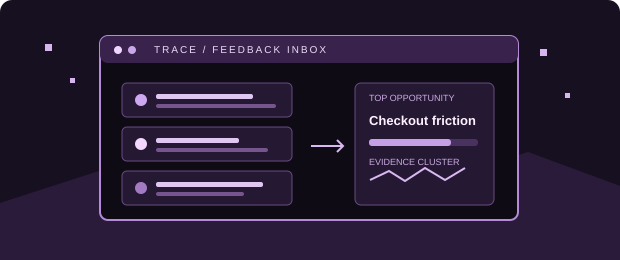
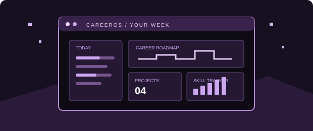

 

# Hi, I'm Charan Teja

**Product · UX · Technology · Operations**

Artificial Intelligence & Machine Learning graduate building products across marketplace, EdTech and AI.

[Portfolio](https://charan.ofzen.in/) &nbsp;·&nbsp; [LinkedIn](https://www.linkedin.com/in/charan-tej-neelam-bb0a9a302) &nbsp;·&nbsp; [Email](mailto:career.charantej@gmail.com)

---

## About me

I'm a B.Tech graduate from **Aditya University** with **1.5+ years of hands-on product and project experience**. I started with technology and design, then moved closer to product by researching user problems, shaping product experiences, defining requirements and working with teams to take ideas from concept to launch.

My work has covered **marketplace, education technology and AI products**. I enjoy connecting user needs, business constraints and engineering execution, and I stay close to the product after launch through feedback, validation and iteration.

I'm currently exploring **Associate Product Manager, Product Management, Product Analyst, Product Operations and Project Coordinator** opportunities in the UAE. Based in Dubai and available to join immediately.

---

## Tech stack and tools

**Product, research and design**

  

**Development**

  

**Data, backend and workflow**

  

  
  
  
  

---

## Featured projects

<table>
<tr>
<td width="50%" valign="top">

### [CodeTracker ↗](https://github.com/Charantej111/Codetracker)

**Competitive coding analytics for students and institutions**

Unifies coding activity from LeetCode, Codeforces, CodeChef, HackerRank, GeeksforGeeks and AtCoder. Students can track progress while faculty and placement teams can review performance across a cohort.

**Product work**
- Gathered requirements from **70+ students and 5+ placement staff**.
- Helped define dashboards, rankings, performance tracking and placement workflows.
- Worked across product thinking, UX, implementation, validation and go-to-market.

**Outcome:** Live at Aditya University, with **8,000+ active student users**.

</td>
<td width="50%" valign="top">

### [InterviewPilot ↗](https://github.com/Charantej111/InterviewPilot)

**Interview practice shaped around the candidate**

Uses a candidate's resume and target role to create relevant interview questions, adaptive follow-ups, structured answer evaluation and feedback.

**Product work**
- Defined the interview setup and candidate workflow.
- Worked on resume and job-description analysis.
- Shaped interview generation, adaptive follow-ups and evaluation.
- Contributed across UX, frontend, backend integration, AI workflows and testing.

</td>
</tr>
<tr>
<td width="50%" valign="top">

### [Trace ↗](https://github.com/Charantej111/Trace)

**Customer feedback connected to product decisions**

Brings app reviews and files such as CSV, Excel and JSON into one workflow to help product teams identify recurring issues, understand evidence and prioritize opportunities.

**Product work**
- Feedback ingestion and normalization.
- Problem grouping and emerging issue analysis.
- Evidence-backed opportunity scoring.
- Product decision records and roadmap traceability.
- Product concept, UX, implementation and validation.

</td>
<td width="50%" valign="top">

### CareerOS

**Career planning and job tracking workspace**

A product for students and professionals with a daily planner, career roadmaps, projects, job tracking and skill development.

**Product work**
- Designed and shipped the MVP to **20 beta users**.
- Built the daily planner, job tracker and AI interview preparation experience.
- Built an AI interview prototype using resume, job description, role and company context.
- Owned the build end-to-end across product design, frontend, backend, database, authentication and deployment.

</td>
</tr>
</table>

### Other product work

**Delizoo** · Hyperlocal food delivery marketplace. Co-founded and worked across product, UX, operations and launch. Helped shape four experiences: customer app, restaurant app, admin panel and rider app.

**ApplyQ** · Job discovery and quick-apply experience for college students, combining on-campus placement opportunities and off-campus jobs. The source repository is private.

---

## Professional experience

### Co-Founder, Product Strategy · Ofzen
*March 2025 – Present*

- Led product strategy across initiatives including CodeTracker and Delizoo.
- Conducted user research to understand market gaps and validate product-market fit before development.
- Wrote product specifications, prioritized roadmaps and coordinated execution across product work.
- Built the CodeTracker go-to-market plan and supported expansion through university partnerships.

### Co-Founder, Product & Operations · Delizoo
*June 2026 – Present · Hyperlocal food delivery marketplace*

- Helped research **40+ restaurant partners and 30+ riders** to understand payouts, trust, delivery operations and marketplace economics.
- Planned and shipped the MVP in **15 weeks** across customer, restaurant, admin and rider experiences, using Figma prototyping and user testing.
- Helped design a **5% commission model** as a lower-cost alternative to incumbent platform commissions.
- Supported onboarding of **40+ kitchen partners and 40+ riders**.
- Reached **2,000+ downloads, 1,600+ customer profiles and 300+ orders** after launch.

### Product Support & Validation Intern · Aditya University
*May 2025 – June 2025*

- Supported product validation, user testing and feedback collection.
- Worked around product support and usability checks to identify issues and improve the user experience.

### AI/ML Intern · Nxt24 Tech Solutions
*June 2024 – August 2024*

- Worked on AI and machine learning projects.
- Built familiarity with model development, implementation and applied ML workflows.

---

## Certifications

- **IBM AI Product Manager Professional Certificate** · IBM / Coursera
- **Google Project Management Professional Certificate** · Google / Coursera

## Recognition and workshops

- **Bajaj HackRx 6.0** · Finalist
- **IIT Bhubaneswar** · Web Development Workshop
- **IoT Workshop** · Technical workshop participation

## Education

**B.Tech, Artificial Intelligence & Machine Learning**  
Aditya University · 2022–2026 · **75% · First Class**

## Skills

| Product management | Design and research | Execution and analytics |
|---|---|---|
| Product strategy and discovery | User flows and journey mapping | Agile and Scrum |
| User research and market research | Wireframing and prototyping | Sprint planning |
| Product specifications and PRDs | Figma and interaction design | Stakeholder communication |
| Roadmap and backlog prioritization | Usability testing | Cross-functional coordination |
| A/B testing and experimentation | Iterative feedback | Power BI and Tableau |
| AI/LLM product applications | Prompt engineering | Product validation and testing |

**Languages:** English (Fluent) · Telugu (Native) · Hindi (Intermediate)

---

## Find me here

  
  
  

**Dubai, UAE** · Available immediately

Project contributions are described by area of involvement. Some products were built collaboratively; CareerOS was an end-to-end build.
