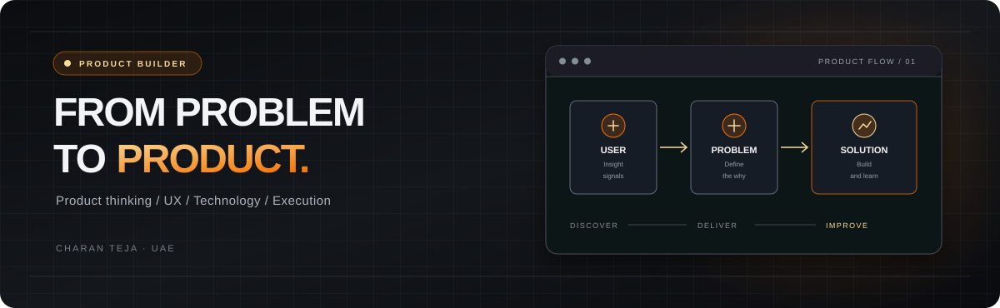
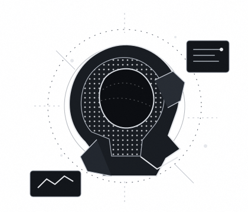

 

# CHARAN TEJA

### Product-minded builder turning **user problems → useful products**

**Product · UX · Technology · Operations**

I like the messy part between an idea and a real product.

 

---

## 01 / ABOUT

<table>
<tr>
<td width="62%" valign="top">

I'm **Charan**, an Artificial Intelligence & Machine Learning graduate from **Aditya University**.

I started with technology and design, then moved closer to product by building real products, understanding users, working with teams, and learning from what happens after launch.

I enjoy connecting the dots between:

> **What users need**  
> **What makes business sense**  
> **What teams can actually build**

**NOW:** Exploring entry-level **Product Management, Associate Product Manager, Product Analyst, Product Operations, and Project Coordination** opportunities across the UAE. Open to Dubai, Abu Dhabi, and immediate joining.

</td>
<td width="38%" align="center" valign="middle">

</td>
</tr>
</table>

---

## 02 / SELECTED WORK

<table>
<tr>
<td width="50%" valign="top">

### [CODETRACKER ↗](https://github.com/Charantej111/Codetracker)

**Coding performance → institutional insight**

Unifies competitive programming activity across platforms into a single experience for students, faculty, and placement teams.

PRODUCT · UX · ANALYTICS

</td>
<td width="50%" valign="top">

### [INTERVIEWPILOT ↗](https://github.com/Charantej111/InterviewPilot)

**Resume + role → adaptive interview**

AI-powered interview preparation using candidate context, role requirements, adaptive follow-ups, structured evaluation, and feedback.

AI PRODUCT · UX · BUILD

</td>
</tr>

<tr>
<td width="50%" valign="top">

### [TRACE ↗](https://github.com/Charantej111/Trace)

**Customer feedback → product decisions**

Turns feedback from app stores and structured files into evidence-backed product opportunities and prioritization inputs.

DISCOVERY · DATA · PRIORITIZATION

</td>
<td width="50%" valign="top">

### CAREEROS

**Career goals → daily execution**

A career planning and progress product covering roadmaps, projects, applications, skills, planning, and consistency.

0 → 1 · PRODUCT · FULL BUILD

</td>
</tr>
</table>

<strong>More product work</strong>

 

**ApplyQ**  
Job discovery and quick-apply experience for college students. Source repository is private.

**Delizoo**  
Food delivery product with cross-functional work across product design, web experience, and launch operations.

Contribution note: CareerOS involved an end-to-end build by me. Other products involved cross-functional work, and the descriptions intentionally avoid claiming sole ownership of every feature or technical system.

---

## 03 / HOW I THINK

### **UNDERSTAND → DEFINE → PRIORITIZE → BUILD → LEARN**

Start with the user problem. Make trade-offs visible. Ship thoughtfully. Improve with evidence.

| PRODUCT | DESIGN | EXECUTION |
|:---:|:---:|:---:|
| Problem framing | User flows | Cross-functional coordination |
| Requirements | Wireframes | Delivery planning |
| Prioritization | Prototyping | Testing & validation |
| Roadmap thinking | Usability | Iteration |

---

## 04 / TOOLKIT

**PRODUCT + DESIGN**

**BUILD + DATA**

---

## 05 / EXPERIENCE

**OFZEN** · Operations Lead  
Product · Operations · Coordination · Delivery

**ADITYA UNIVERSITY** · Product Support & Validation Intern  
May 2025 → June 2025

**NXT24 TECH SOLUTIONS** · AI/ML Intern  
June 2024 → August 2024

 

**HIGHLIGHTS**

BAJAJ HACKRX 6.0 · FINALIST  
NPTEL · ELITE SILVER · IoT  
B.TECH AIML · 75% · FIRST CLASS

---

## 06 / GITHUB

<table>
<tr>
<td align="center" width="250">

# 166

**CONTRIBUTIONS**

Current profile count

</td>
<td align="center" width="360">

</td>
</tr>
</table>

### CONTRIBUTION ACTIVITY

---

## LET'S BUILD SOMETHING USEFUL.

**Open to Product, Product Analyst, Product Operations, APM and Project Coordination opportunities in the UAE.**

[Portfolio](https://charan.ofzen.in/) · [LinkedIn](https://www.linkedin.com/in/charan-tej-neelam-bb0a9a302) · [Email](mailto:charantej111n@gmail.com)

 

Dubai · Abu Dhabi · UAE · Available to join immediately

